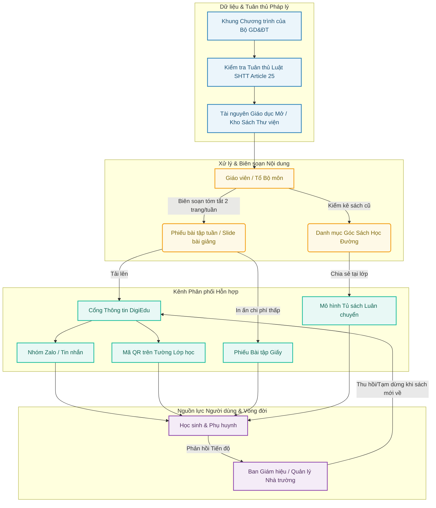

# DigiEdu - Cổng Tài Liệu Học Tập Chuyển Tiếp & Góc Sách Học Đường


> **Mô hình phối hợp Giáo dục Số & Học liệu Vật lý** nhằm hỗ trợ học sinh tiếp cận tài liệu bài giảng chuẩn hóa, tiết kiệm chi phí và tuân thủ Luật Sở hữu Trí tuệ.

---

## 📌 1. Tổng quan Dự án

Trong các giai đoạn chuyển tiếp chương trình học hoặc thiếu hụt sách giáo khoa cục bộ, phụ huynh và học sinh gặp khó khăn trong việc tiếp cận tài liệu chuẩn hóa với chi phí hợp lý. **DigiEdu** giải quyết bài toán này bằng mô hình Hybrid Distribution:

- **Số hóa linh hoạt**: Tóm tắt bài học weekly & slide giảng dạy phân phối qua Cổng thông tin, Zalo OA và Mã QR tại lớp.
- **Tối ưu chi phí**: In ấn học liệu giấy giá rẻ & vận hành **Tủ sách luân chuyển** từ nguồn sách cũ đóng góp.
- **An toàn pháp lý**: Đảm bảo toàn bộ tài nguyên trích dẫn đều thông qua quy trình kiểm tra Điều 25 Luật SHTT và khai thác Tài nguyên Giáo dục Mở (OER).

---

## 🔄 2. System Architecture



---

## 🧩 3. Core Modules

### 3.1. Dữ liệu & Pháp lý

* **Khung chương trình**: Chuẩn hóa theo định hướng GDPT của Bộ GD&ĐT.
* **Rà soát SHTT (Article 25)**: Kiểm tra giới hạn quyền tác giả cho mục đích giảng dạy phi thương mại.
* **Kho OER**: Tích hợp các kho học liệu mở công cộng.

### 3.2. Biên soạn & Số hóa 

* **Tóm tắt tuần (Weekly 2-pager)**: Bài giảng tóm gọn trong 2 trang A4 nhằm tối ưu trải nghiệm đọc nhanh và chi phí in.
* **Góc sách học đường**: Kiểm kê, dán mã quản lý và phân loại sách giáo khoa/sách tham khảo cũ do học sinh quyên góp.

### 3.3. Phân phối Đa kênh

* **Kênh Số**: Cổng thông tin Web, Bot nhắn tin Zalo tự động, QR Code dán cố định tại các bảng tin lớp học.
* **Kênh Vật lý**: Phiếu bài tập in đen trắng chi phí thấp, Tủ sách luân chuyển theo tuần giữa các lớp.

### 3.4. Vòng đời & Phản hồi 

* **Học sinh & Phụ huynh**: Tiếp cận học liệu mọi lúc, gửi phản hồi tiếp thu.
* **Ban Giám hiệu**: Theo dõi tỷ lệ phủ học liệu và điều phối thu hồi/đóng cổng khi sách giáo khoa chính thức được giao tới.

---

## 📂 4. Cấu trúc Thư mục Repository

```text
digi-edu/
├── docs/                     # Tài liệu thiết kế & Hướng dẫn pháp lý
│   ├── legal-compliance.md   # Hướng dẫn rà soát Luật SHTT Điều 25
│   └── architecture.md       # Chi tiết kiến trúc hệ thống
├── src/                      # Mã nguồn ứng dụng (Đang phát triển)
│   ├── frontend/             # Giao diện Cổng DigiEdu (Web/App)
│   ├── backend/              # API Server & Quản lý cơ sở dữ liệu
│   └── integrations/         # Service kết nối Zalo OA & QR Generator
├── database/                 # Schema & Scripts cơ sở dữ liệu
│   └── schema.sql            # Quản lý kho sách & phân phối tài liệu
├── README.md                 # Tài liệu giới thiệu dự án
└── LICENSE                   # Giấy phép bản quyền MIT

```

---


```
